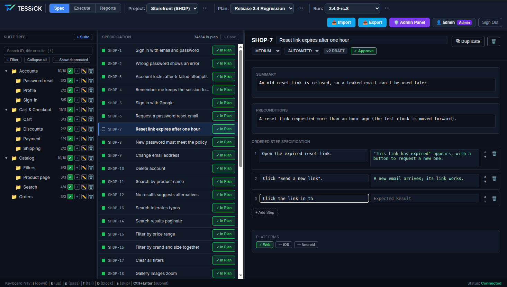
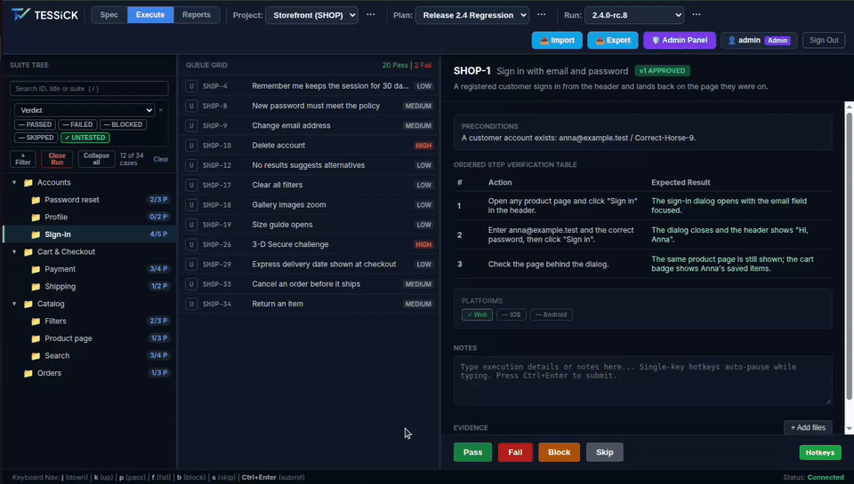
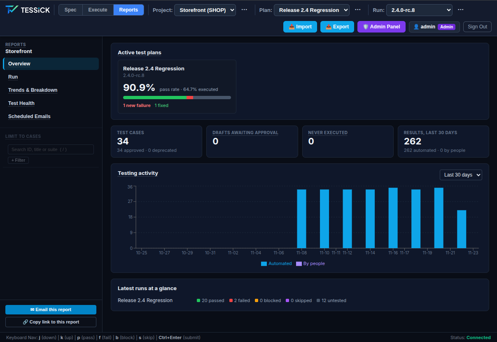

# Using Tessick: the web app

This guide walks through Tessick's screens in the order you'd use them: signing in, writing test cases, planning, running tests, reading reports, moving data in and out, and administering the server. It's for testers, test leads and admins.

Other guides cover the rest:
- Installing and configuring Tessick: [deployment.md](deployment.md).
- Bringing your cases (or your whole database) over from TestLink: [migrating_from_testlink.md](migrating_from_testlink.md).
- Scripts and CI: [api_getting_started.md](api_getting_started.md). Reports over the API, and AI agents over MCP: [reports_api_and_mcp.md](reports_api_and_mcp.md).

To follow along with data, start the demo (see [Try it in a minute](../README.md#try-it-in-a-minute)): it has a project with eight runs of results.

**Contents**
1. [Signing in and choosing a project](#1-signing-in-and-choosing-a-project)
2. [Spec mode: suites and test cases](#2-spec-mode-suites-and-test-cases)
3. [Test plans and runs](#3-test-plans-and-runs)
4. [Execute mode: running tests](#4-execute-mode-running-tests)
5. [Reports](#5-reports)
6. [Import and Export](#6-import-and-export)
7. [The Admin Panel](#7-the-admin-panel)
8. [My Account](#8-my-account)
9. [Who can do what](#9-who-can-do-what)

## 1. Signing in and choosing a project

### Signing in

Sign in with your username (or email) and password. Your administrator gives you these: there's no self-registration, and **Forgot password?** only tells you to ask them.

- **The first sign-in on a new server** is `admin`. Its password is the one set in `ADMIN_PASSWORD`, or a random one printed once in the server's log, which Tessick makes you change straight away.
- **A password an admin has reset** is temporary: Tessick asks you to choose a new one (**Choose a new password**) before anything else.
- **Passwords** are 8 to 100 characters. Under 16 characters, they need a digit, an uppercase letter and a symbol; from 16 characters, anything goes.
- **Wrong passwords:** 20 in a row lock the account for 15 minutes (an admin can unlock it sooner), and 50 failures from one address in 15 minutes block that address.
- **How long you stay signed in:** 8 hours without using Tessick, and 7 days at most. When it ends, the sign-in page says "Your sign-in has ended".

### The header

Everything starts from the bar at the top:

| | |
| :--- | :--- |
| **Spec / Execute / Reports** | The three views. **Spec** is for writing tests, **Execute** for running them, and **Reports** for the results. Tessick opens in Spec. |
| **Project** | The project you're working in. Each project has a name and a prefix (`SHOP`), which starts its case ids (`SHOP-12`). |
| **Plan** | A test plan in the project: a chosen set of cases to run. Archived plans are hidden; the list's last entry, **Show archived plans**, shows them. |
| **Run** | A test run of the plan: one round of testing, such as a build or a release candidate. Closed runs say **[CLOSED]**. |
| **⋯** next to each | New, edit and delete. You only see what your role allows. |
| **📥 Import, 📤 Export** | Bringing cases in, and taking cases and results out ([section 6](#6-import-and-export)). |
| **🛡️ Admin Panel** | Users, roles, custom fields, API tokens, webhooks, email and the audit log ([section 7](#7-the-admin-panel)). Shown only to people who manage one of these. |
| **👤 your name** | My Account ([section 8](#8-my-account)). **Sign Out** is next to it. |

The bottom bar repeats the main hotkeys, and on the right shows what happened to the last result you recorded.

**Projects:** the project list shows only projects you can view or run tests in. To create one, use **⋯ → ➕ New project** next to Project, and give it a name and a prefix: a letter followed by letters or digits, at most 10 characters. The prefix can't change once the project has cases.

**Deleting** a project, plan, run, suite or case that holds anything first shows an amber warning saying what would be lost; **Delete Anyway** goes ahead. There's no trash: deleted is gone.

**Coming back to the window** refreshes what you're looking at, so runs and results CI sent, or cases an AI agent wrote, show without reloading the page.

## 2. Spec mode: suites and test cases

Spec mode has three panes:
1. **The suite tree** (left): the project's suites, nested like folders, with search and filters above it.
2. **The case list** (middle): the cases in the selected suite. With no suite selected, it lists every case.
3. **The details** (right): the selected case, or the selected suite.

The panes' widths can be changed by dragging the lines between them.

### Suites

- **New suite:** **+ Suite** at the top of the tree makes a top-level suite; the **+** on a suite's row makes one inside it. Suites nest up to 27 levels.
- **Rename or move:** the ✏️ on its row opens **Rename / Move Suite**, with its name and its parent. You can also rename it in the details pane, or drag it onto another suite (or onto the top-level area that appears while dragging).
- **Delete:** the 🗑️ on its row. A suite with cases or sub-suites asks first, and **Delete Anyway** deletes everything in it, with its results.
- **Expand all / Collapse all**, under the search box, opens or closes every suite. The keys `]` and `[` do the same, in both modes.

Clicking a suite lists its *own* cases in the middle pane (not those of its sub-suites) and shows its details on the right: how many cases it holds, how many are in the selected plan, and the suite's custom fields.

### Test cases

- **New case:** select a suite, click **+ Case** above the case list, and give it a title, a priority (LOW, MEDIUM, HIGH or CRITICAL) and an execution type (MANUAL or AUTOMATED).
- **Ids** are given by Tessick, in order: `SHOP-1`, `SHOP-2`, and so on.
- **Moving cases:** drag them onto a suite in the tree. Shift-click selects a range and Ctrl-click (Cmd-click on a Mac) adds one at a time; dragging any of them moves them all. Esc clears the selection.
- **The small square** before each case shows its latest version: an outline for a draft, filled green for approved.
- **Delete:** 🗑️ in the case's details. A case that's in a plan or has results asks first.

A case's details show its id and title, its priority and execution type, its version and status, and then its content:
- **Summary**: what the case checks.
- **Preconditions**: what must be true before you start.
- **Steps**: each an **Action** and an **Expected Result**. **+ Add Step** adds one; ▲ ▼ reorder them and 🗑️ removes one.
- **Custom fields**, if your administrator has defined any.

Changes save as you leave each field ("Saving…" shows while they do). There's no Save button.

### Versions: draft, approved, deprecated

A case's content (summary, preconditions and steps) is versioned. Its title, priority and execution type aren't, and can be changed at any time.

| Status | What it means | Buttons |
| :--- | :--- | :--- |
| **DRAFT** | Being written. The content is editable. | **✓ Approve** |
| **APPROVED** | Ready to run. The content is read-only. | **Edit**, **Deprecate** |
| **DEPRECATED** | Retired: hidden from the case list, and can't be added to plans. | **↺ Restore** |

- **New cases start as drafts**, unless your role approves them automatically (`SPEC_AUTO_APPROVE`, which Admin and Test Lead have). A case with a required custom field that isn't filled in still starts as a draft.
- **To change an approved case**, click **Edit**. It makes a new draft (version 2, 3, …) copying the latest version; change it, then **✓ Approve** it.
- **Approving** a new version moves the case to that version in every **ACTIVE** plan, so the next results are against the new steps. LOCKED and ARCHIVED plans keep the version they had.
- **Deprecate** retires a case without deleting it or its results. To see deprecated cases, turn on **Show deprecated** under the search box; open one and click **↺ Restore** to make it approved again.
- **⧉ Duplicate** makes a new case from this one: a copy of its latest version and its custom-field values, in the same suite. The copy is always a draft, for you to edit and approve.

### Custom fields

Admins define custom fields ([section 7](#custom-fields-1)): for example a component, a platform list or a ticket link. They appear at the bottom of a case's or suite's details, as text, number, checkbox, date, single-select or multi-select inputs.

- A case's custom fields are editable while it's a draft, like its content. A suite's are always editable.
- Changing them needs plan management permission (`PLAN_MANAGE`, which Admin and Test Lead have).
- Values aren't versioned: a case has one value per field, whatever its version.
- A required field always has a value: new cases get its default.
- In Execute mode, custom fields are shown read-only.

### Search and filters

The box above the tree (`/` jumps to it) searches case ids, titles and suite names. The tree then shows only suites holding a match, and the count under it says how many cases match.

**+ Filter** adds a condition on a property:
- **Built-in:** Priority, Execution Type, Status (DRAFT, APPROVED, DEPRECATED), In Plan (needs a plan) and Verdict (needs Execute mode and a run).
- **Case fields** and **Suite fields:** your custom fields. Each can also match **(no value)**, and a multi-select can match **any** or **all** of the chosen options.

Several filters must all match. **Clear** removes the search and every filter. Search doesn't look inside custom-field values: filter on them instead.

## 3. Test plans and runs

### Test plans

A **test plan** is the set of cases to run for something: a release, a sprint, a regression pass. It pins each case at a version, so a case edited later doesn't change under the people testing it until it's approved again.

- **New plan:** **⋯ → ➕ New plan** next to Plan. It starts empty.
- **Status** (**⋯ → ✏️ Edit plan**):
  - **ACTIVE**: the normal state.
  - **LOCKED**: frozen. No results can be recorded and its cases can't change.
  - **ARCHIVED**: frozen like LOCKED, and hidden from the Plan list.

**Adding cases** happens in Spec mode, with the plan chosen in the header:
- Each case's row has **+ Add**, or **✓ In Plan** when it's in the plan. Click it to add or remove the case.
- Each suite's row in the tree shows how many of its cases are in the plan (`3/5`); its square adds or removes all of them, sub-suites included.
- Only approved cases can be added. A draft's **+ Add** is greyed out until it's approved.

**Removing a case that has results** asks first (an amber banner, **Remove anyway**). It isn't deleted from the plan's history: old runs keep it, with its results, read-only, marked **REMOVED**. Adding it back lets it be tested again.

### Test runs

A **test run** is one round of testing a plan: "2.4.0-rc.8", "Sprint 12", "Nightly 2026-11-23". Each run has its own results; a plan's runs show how it moves over time.

- **New run:** **⋯ → ➕ New run** next to Run. It needs a plan.
- CI can make runs too: a JUnit upload names its run, and Tessick creates it the first time ([api_getting_started.md](api_getting_started.md)).
- **Closing a run** stops results being recorded in it. In Execute mode, **Close Run** (under the search box) closes it and **Open Run** reopens it; the run's **Status** in **⋯ → ✏️ Edit run** does the same.
- **A run closes by itself** the first time every case in it has a result recorded in the web app. It does this once only: reopened, it stays open. Results sent by CI never close a run by themselves.

## 4. Execute mode: running tests

Choose a plan and a run in the header, then click **Execute**.

- **The suite tree** shows only suites with cases in the plan. Each shows how many of its cases passed in this run (`2/3 P`).
- **The queue** (middle) lists the plan's cases in tree order. Each has a badge for its result in this run: **P** passed, **F** failed, **B** blocked, **S** skipped, **U** untested. The header counts passes and failures.
- **The right pane** shows the selected case: its summary, preconditions, steps, custom fields, **Notes** and **Evidence**, with **Pass**, **Fail**, **Block** and **Skip** at the bottom.

### Narrowing the queue

- **Click a suite** to list only its own cases. A 📁 chip above the queue names it; click it, or the suite again, to see everything. Parent suites with no cases of their own show an empty queue, so click their sub-suites.
- **Search and + Filter** work as in Spec mode. **Verdict → UNTESTED** is the usual one: it lists what's left to do, and each case drops off the list as you record it.

### Recording results with the keyboard

| Key | What it does |
| :--- | :--- |
| `j` / `k` (or ↓ / ↑) | Next / previous case |
| `p` | **Pass**, and move to the next case |
| `s` | **Skip**, and move to the next case |
| `f` | **Fail**, and put the cursor in Notes |
| `b` | **Block**, and put the cursor in Notes |
| Ctrl+Enter (Cmd+Enter) | In Notes: save the notes and go to the next case |
| Esc | Leave Notes without moving |
| `/` | Jump to the search box |
| `[` / `]` | Collapse / expand every suite in the tree |

The buttons at the bottom do the same as the keys. A typical pass: filter to UNTESTED, press `j`, then `p`, `p`, `p`… and on a failure `f`, type what went wrong, Ctrl+Enter.

- **Hotkeys pause while you type** in any box, so you can type notes freely. The **Hotkeys** pill at the bottom right shows their state: green when active, amber while typing, red when you can't record results. Click it to turn the single-key hotkeys off, and again to turn them back on.
- **At the end of a suite**, `p` and `s` carry on into the next suite's cases, and so does Ctrl+Enter.
- **The status bar** confirms each result ("Recorded SHOP-8 → PASSED"). If one isn't recorded, the case goes back to how it was and a banner or message says why.

### Notes

**Notes** are kept with any verdict, not just failures. Type them before or after choosing the verdict. They save with Ctrl+Enter, and also when you click away from the box.

A failed or blocked case that completes the run doesn't close it until its notes are saved, or until you move to another case. If notes can't be saved (the run was closed meanwhile, say), a **Notes not saved** banner keeps them, with **Copy notes**.

### Recording again

Results are never edited: a new result for a case becomes its latest, and the earlier ones stay in its history.

- Changing a case's result in a run that already has one needs `EXECUTE_OVERWRITE` (Admin and Test Lead). A Tester who tries is told so in a yellow banner, and nothing is saved.
- Re-sending your own latest verdict, to add notes, is always allowed.
- No results can be recorded in a **closed** run, in a LOCKED or ARCHIVED plan, or for a case **removed** from the plan.

### Evidence

Evidence is the files that show what happened: screenshots, videos, logs and Playwright traces. It belongs to a case's result in a run, so **record the result first**; until then the Evidence section says so.

**Adding files**, to the selected case:
- **+ Add files** picks them.
- **Drop** files anywhere on the right pane.
- **Paste** a screenshot (Ctrl+V or Cmd+V) anywhere in Execute mode. Pasting text into Notes or search works as usual.

Each upload shows its progress. Accepted files are PNG, JPEG, GIF or WebP images, MP4 or WebM videos, text logs, and Playwright trace `.zip` files. Tessick checks each file's contents, not its name, and refuses anything else. A case can have up to 50 files in a run, each up to 200 MB by default (your administrator can change this). The same file added twice is kept once.

**Viewing:** click a file to open the viewer. Images and videos play there; a log shows as text (the first 1 MB); a Playwright trace is downloaded and opened with `npx playwright show-trace`, or on trace.playwright.dev. ← and → step through the case's files, **Download** saves one, and Esc closes the viewer. The hotkeys pause while it's open.

**When evidence can be added and deleted:**
- Anyone who can record results can add evidence while the run is open.
- For 24 hours after a run closes, the person who recorded a case's result can still add to it (the viewer marks these "added after the run closed").
- The person who uploaded a file can delete it while the run is open, and so can anyone with `EXECUTE_OVERWRITE`. Deleting asks first, and is recorded in the audit log.

CI and AI agents can attach evidence too: see [api_getting_started.md](api_getting_started.md).

## 5. Reports

Click **Reports** in the header. The reports cover the project, plan and run chosen in the header; change them there, and the report follows.

| Report | What it shows |
| :--- | :--- |
| **Overview** | Every active plan's latest run compared with the one before it, case counts (drafts awaiting approval, cases never executed), the drafts waiting longest, and testing activity per day (by CI or by people). Click a plan to open its run. |
| **Run** | The selected run: pass rate, how many cases were executed, failures with their errors and notes, and what changed since another run (new failures, fixed, still failing, not run this time). **Compare to** chooses the other run. **Copy as Markdown** copies a summary for a pull request, chat or ticket. |
| **Trends & Breakdown** | The plan across its last 5 to 50 runs (results and pass rate per run), and a breakdown of the cases by suite, priority, execution type, status, tester or a custom field. |
| **Test Health** | Over the plan's recent runs: flaky cases (passing and failing by turns), cases always failing, the slowest, those getting slower, and stale ones (not run for a number of days). |
| **Scheduled Emails** | Report emails sent daily or weekly (below). |

- **Pass rate** is passed ÷ executed: untested and skipped cases don't count.
- **Durations** come only from automated results: results recorded by people aren't timed.
- **Click a case** in any report to see its history: every result across runs, its pass rate and its current streak. **Open this case in Specification mode** takes you to it.
- **Limit to cases**, in the left column, narrows every report but the Overview to the cases matching a search and filters (a suite, a priority, a custom field…).
- **CSV** next to a table downloads it.
- **🔗 Copy link to this report** copies a link to exactly what's on screen, to send to a colleague.

### Report emails

With `REPORT_EMAIL` (Admin and Test Lead):
- **✉ Email this report** sends the report on screen to any addresses, with a note of your own. Recipients don't need a Tessick account.
- **Scheduled Emails** sends them automatically, daily or weekly at a time you choose (with its time zone). Each schedule includes any of: the latest run summary, the plan trend, test health and the project overview. **Only when there's a new run** skips the email when nothing new ran.

Email needs a mail server, set up by an admin ([Email](#email)). Without one, emails are only captured, and the Admin Panel shows the last one.

Scripts and AI agents get the same reports through the API and MCP: see [reports_api_and_mcp.md](reports_api_and_mcp.md).

## 6. Import and Export

### Import

**📥 Import** (needs `IMPORT_DATA`) brings suites and cases in from a file, in five steps:

1. **Upload:** the file, its format and the project to import into. **Auto-detect** recognises TestLink XML, Tessick's JSON, CSV and JUnit XML; choose **TestRail CSV** yourself. **Preview Import →** reads the file and changes nothing yet.
2. **Field Mapping:** custom fields in the file that the project doesn't have. For each: create a new field (with a suggested type), put its values in an existing field, or drop it. Fields with the same name as one the project has are matched for you.
3. **Duplicates:** what will be created, and what to do with a case whose id is already in the project: **Create a new version** (recommended: its results stay), **Overwrite the latest version**, **Create a new, separate case**, or **Skip it**. So the same file can be imported again without making copies.
4. **Confirm:** a summary. **Run Import** writes it all at once.
5. **Results:** what was imported, and any values that didn't fit their field.

Files can be up to 50 MB. Afterwards, Tessick opens the project in Spec mode to show what arrived. Moving from TestLink has its own step-by-step guide: [migrating_from_testlink.md](migrating_from_testlink.md).

### Export

**📤 Export** (needs `EXPORT_DATA`) downloads:
- **Suite/Case Definitions:** the whole project, one suite (with its sub-suites), or a plan's cases at their pinned versions; all statuses or approved only.
- **Execution Results:** one run's results.

Formats:
- **Native JSON** keeps everything, and imports back into Tessick.
- **Standard CSV** is for spreadsheets. It leaves out environment tags, and cells that a spreadsheet would run as formulas are made safe.

## 7. The Admin Panel

**🛡️ Admin Panel** in the header is shown to anyone who manages users, custom fields, API tokens or webhooks, and each tab only to those who manage it.

| Tab | Who sees it |
| :--- | :--- |
| User Roster, Privilege & Access Matrix, Role Templates, Security Audit Log | `USER_MANAGE` |
| Custom Fields | `CUSTOM_FIELD_MANAGE` |
| API Tokens | `API_TOKEN_MANAGE` |
| Webhooks | `WEBHOOK_MANAGE` |
| Email | System admins only |

Some limits apply to every admin: you can't grant a permission you don't hold, you can't change a user or role that outranks you, and the last active admin can't be removed.

### Users

**👥 User Roster** lists every user, with their global role and status.
- **Add New User:** username, email, a first password and a global role (Tester by default).
- **Reset Password** gives the user a temporary password, shown once, for you to pass on privately. Their sessions end, and they choose a new password when they sign in.
- **Disable** ends the user's sessions, stops their API tokens and removes their TestLink API key. **Activate** brings the account back.
- **Unlock** appears when an account is locked after too many wrong passwords.
- **Remove TL Key** removes a user's TestLink API key, so scripts using it stop at once.

### Roles and overrides

A user's permissions come from roles:
- **The global role** applies in every project, including ones created later.
- **A project role** replaces the global role in that project.
- **Overrides** switch single permissions on or off for a user, everywhere or in one project. They have the final say.

All three are set in **🔑 Privilege & Access Matrix**: pick a user on the left, then change their **Global System Role**, a project's role (**Same as global role** by default), or click permissions under **Individual Permission Overrides** to force them on or off. Changes save as you make them.

**To limit someone to some projects**, give them the **No Access** global role and a role in each project they should see.

**🎭 Role Templates** edits the roles themselves: their names, descriptions and permissions. The built-in ones are Admin, Test Lead, Tester, Viewer, Automation Service and No Access ([section 9](#9-who-can-do-what)). Any role can be changed, and deleted once no one uses it.

### Custom fields

**🏷️ Custom Fields** defines the fields shown on test cases and suites.
- **Applies To:** Test Case or Test Suite.
- **Field Type:** Text, Number, Checkbox, Date, Single-select or Multi-select. Select types list their **Options**.
- **Name** (an internal key) and **Label** (what testers see).
- **Required**, with a **Default Value**. A required field must have a default, and every case gets it. Checkboxes can't be required.
- **Validation Regex** (optional) checks text values.
- **Projects:** all projects, or chosen ones. Adding a project gives its cases the default; removing one deletes the field's values there, after a warning.

Creating a field fills in its default on every existing case or suite. Removing an option deselects it everywhere.

### API tokens

**🔑 API Tokens** makes tokens (`tk_ci_…`) for CI and AI agents. Each works in one project only.
- **Expires:** optional. Without it, the token works as long as you can manage tokens in that project.
- **Works with:** the REST API and MCP, MCP only, or the REST API only. Give AI agents **MCP only** tokens: MCP's own limits (cases an agent writes are drafts, and so on) hold only on MCP.
- **Capabilities:** what the token may do, up to your own permissions. System-wide permissions (users and roles, custom fields, creating or deleting projects, tokens, webhooks) can't be given to a token. An amber warning shows when an agent's token could approve test cases.

The token is shown once, when it's made: copy it then. A token stops working if the person who made it is disabled, and loses anything they no longer hold. [api_getting_started.md](api_getting_started.md) shows how to use one.

### Webhooks

**🔔 Webhooks** sends a project's events to other systems as they happen.
- **URL** and **Format:** a chat message (Slack, Mattermost, Rocket.Chat, Discord), a Microsoft Teams card, or a signed JSON event for your own code.
- **Events:** runs created or closed, results recorded or failing, test cases created, approved, deprecated or restored, and imports completed.
- **Send test** sends a ping. **Deliveries** lists the last 30 days of them, with each answer, and **Send again** resends one.

Failed deliveries are retried for about 11 hours. A webhook whose deliveries have all failed for 3 days is paused, and the audit log says why; click its switch to send again. The webhook's signing secret can be replaced with **Replace secret**.

### Email

**✉ Email** (system admins) sets up the outgoing mail server (SMTP) used for report emails. **Send test email** checks it, and **Last email** shows what was sent last, with a preview. Until a mail server is set, emails are only captured there, not sent.

### Security audit log

**📋 Security Audit Log** lists security-relevant changes: sign-ins and lockouts, users and roles, permissions, tokens, webhooks, evidence, deletions and more, with who did it, from where, and what changed. Evidence added by one person to one run in the same hour shows as one line; click it to list each file.

## 8. My Account

Click your name in the header.

- **New Password:** enter your current password with it. Changing it signs you out everywhere else.
- **Update Email**, and **Update Username** for admins.
- **TestLink API key:** for scripts and tools written for TestLink's REST API, which keep working against Tessick with only the address changed. **Make a key** shows it once: copy it then. Scripts send it as the `APIKEY` header to `/lib/api/rest/…` on your Tessick server, and it acts as you, with your permissions. You have one key at a time; a new one replaces the old. [testlink_compat_api.md](testlink_compat_api.md) has the details.

## 9. Who can do what

The built-in roles, as they come (admins can change them):

| | Admin | Test Lead | Tester | Viewer | Automation Service |
| :--- | :---: | :---: | :---: | :---: | :---: |
| View suites, cases and reports | ✓ | ✓ | ✓ | ✓ | ✓ |
| Create and edit cases (drafts) | ✓ | ✓ | ✓ | | |
| Approve, deprecate and restore cases; delete cases and suites | ✓ | ✓ | | | |
| New cases start approved | ✓ | ✓ | | | |
| Manage plans and their cases; edit custom-field values | ✓ | ✓ | | | |
| Create, close and delete runs | ✓ | ✓ | | | ✓ |
| Record results | ✓ | ✓ | ✓ | | ✓ |
| Change an existing result | ✓ | ✓ | | | |
| Import | ✓ | ✓ | | | |
| Export | ✓ | ✓ | ✓ | ✓ | |
| Email reports and schedule them | ✓ | ✓ | | | |
| Manage API tokens and webhooks | ✓ | ✓ | | | |
| Manage users, roles and custom fields; create and delete projects | ✓ | | | | |

**No Access** grants nothing: as a global role, it limits a user to the projects where they're given a role.

Someone who can record results but not view the specification works in Execute mode only, and sees Reports only with `SPEC_VIEW`. When a button you'd expect is missing or greyed out, hovering over it usually says which permission it needs.
